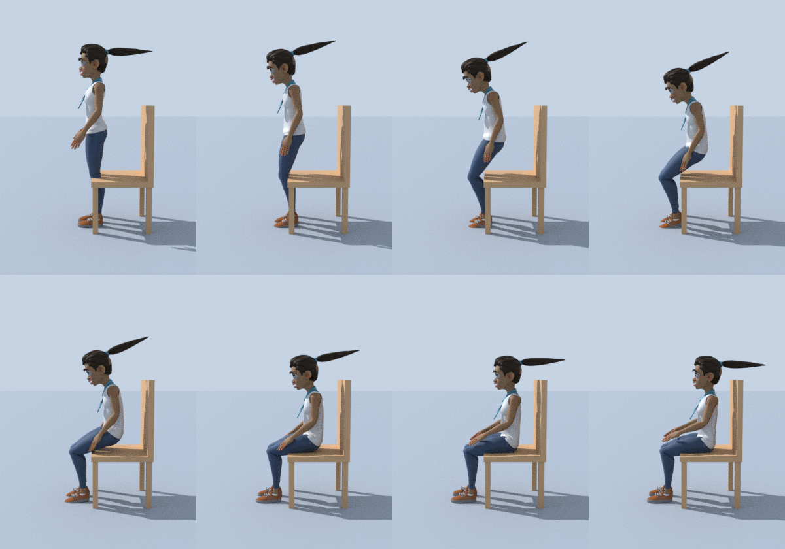
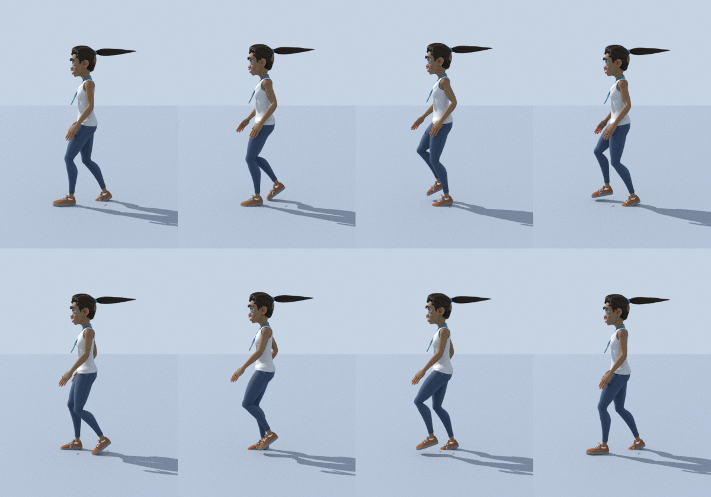

# Blender Animation Lab

An experiment in driving Blender entirely from Python: take a rigged, textured human,
and author animations (sit, stand, walk, run, jump, wave, crouch, punch, cheer, idle)
as code. Everything runs headless through the `bpy` module -- no Blender install or GUI.




## Continuous performance

`python blender/showcase.py` bakes one 34 s take (walk, pivot, sit, stand, jump, walk, run, slow, wave) and renders it: [docs/previews/rain_showcase.mp4](docs/previews/rain_showcase.mp4). Walk/run/pivot/back-step are one speed-driven gait with world-latched feet and heel-to-toe foot roll; posture clips are cross-faded per bone (see `anim_lab/sequencer.py`, and [docs/MOTION_NOTES.md](docs/MOTION_NOTES.md) for the research behind it).

## Run it

```bash
python3.13 -m venv .venv && . .venv/bin/activate
pip install -r requirements.txt

python blender/build.py                       # Rain, all animations -> output/rain_animated.blend + .glb
python blender/build.py --preview sit_down    # also render a contact sheet to output/
python blender/build.py --character superhero_male
```

Open `output/<character>_animated.blend` in Blender: every animation is an Action
(`idle`, `walk`, `run`, `jump`, `sit_down`, `stand_up`, `wave`, `crouch`, `punch`, `cheer`).
The `.glb` carries the same clips for game engines / web viewers.

## How it works

```
characters/<name>.json   proportions (heights of hips, knees, shoulders...) + which meshes to use
anim_lab/humanoid.py     builds ONE canonical armature from a profile (IK legs, pole targets)
anim_lab/swap.py         imports a character's meshes and skins them to that armature
anim_lab/actions.py      the animations -- they only talk to the canonical armature
anim_lab/rig.py          pose / keyframe helpers (rig-independent, scales to character height)
anim_lab/scene.py        ground, chair, lights, camera, headless Cycles render settings
anim_lab/preview.py      contact sheets
build.py                 glue: profile -> rig -> mesh -> actions -> .blend / .glb / previews
tools/prepare_rain.py    one-time: bake Blender Studio's Rain into rig-free textured meshes
```

### Swapping the character

The animations never reference a character's own skeleton, only the canonical rig, so a
new character is just data:

1. Put its mesh (`.glb/.gltf/.fbx/.obj/.blend`, in a T-pose facing -Y) in `blender/assets/`.
2. Add `blender/characters/mychar.json` -- copy `rain.json` and set the landmark heights
   (`hip_z`, `knee_z`, `shoulder_z`, ...) in metres, plus `meshes`. Parts that should
   ride rigidly on the head (eyes, hair) go in `rigid_head`.
3. `python blender/build.py --character mychar`

`rain` (stylised, CC-BY) and `superhero_male` (realistic, CC0) are both built this way and
share every animation. Sit height, stride and jump scale to each profile.

### Writing an animation

```python
def my_move(r):
    r.begin_action("my_move")
    stand(r, drop=0.2)                                   # crouch a bit
    arm(r, "R", ((1.0, 0.0, 0.3), (0.2, 0.3, 1.0)))      # aim upper arm / forearm: (out, forward, up)
    feet(r, l=(0.3, 0, 0))                               # IK foot 0.3 forward
    r.key(0)
    ...
    return r.end_action(loop=False)
```

## Notes / limitations

- Arms and legs use aim/IK posing; fingers, face and cloth/hair are not animated.
- Skinning is Blender's automatic heat weighting, so deformation at shoulders and hips is
  good but not hand-polished.
- The free Quaternius pack only includes the adult body; Rain is the young stylised one.
- Previews render with Cycles on CPU (the container has no GPU/EGL).

Credits and licences: see [CREDITS.md](CREDITS.md).
